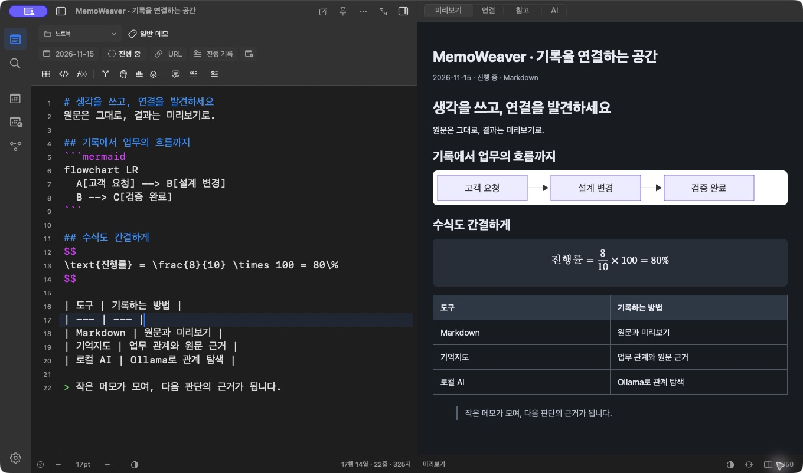
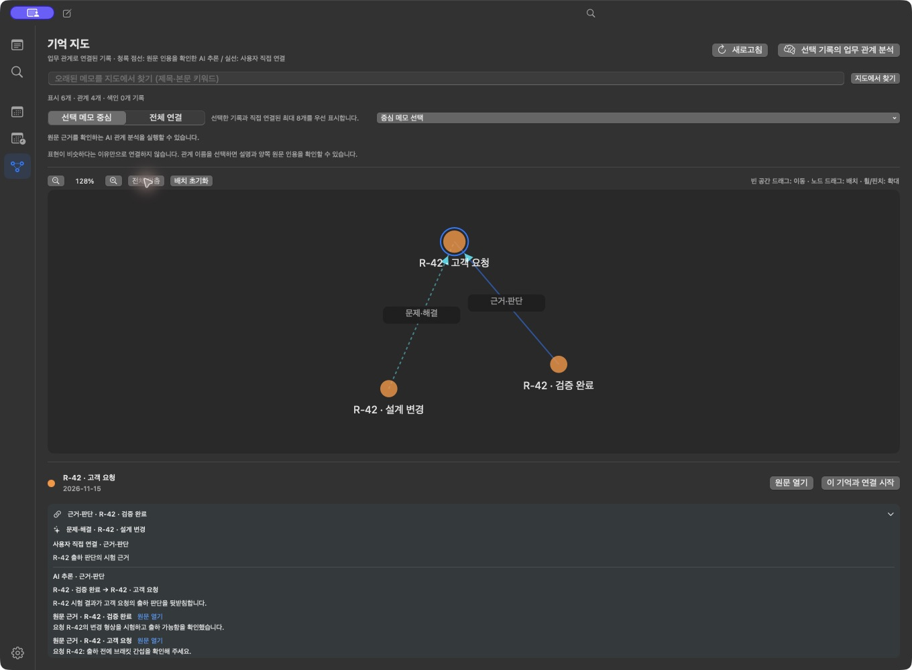

# MemoWeaver

원문으로 쓰고, 미리보기로 확인하고, 업무의 연결을 기억하세요.

MemoWeaver는 메모를 Mac에 저장하는 macOS 앱입니다. Markdown 원문과 미리보기를 나란히 보며 작성하고, 메모 사이의 업무 관계와 원문 근거를 기억지도에서 탐색할 수 있습니다. Ollama를 통한 로컬 AI는 필요한 때 선택해서 사용합니다.

**현재 버전: v0.9.69 · 빌드 102 · 검증 후보(QA)**

[변경 이력](docs/releases/CHANGELOG_v0.9.69.md) · [설치·업데이트 안내](docs/INSTALL.md) · [문서 모음](docs/README.md)



*실제 앱 UI에 소개용 예시 메모를 넣은 화면입니다. 개인 메모는 사용하지 않았습니다.*

## 주요 기능

- **원문과 미리보기 분리**: Markdown을 직접 편집하면서 결과를 옆에서 확인합니다.
- **다양한 문서 표현**: LaTeX 수식, Mermaid 다이어그램, Markmap 마인드맵, 표와 코드 블록을 작성합니다. 렌더링 리소스는 앱에 포함됩니다.
- **메모 연결과 역방향 링크**: `[[메모 제목]]`으로 연결하고, 이 메모를 참조하는 다른 메모를 확인합니다.
- **업무 관계 중심 기억지도**: 직접 만든 연결과 AI가 제안한 업무 관계를 살펴보고, 관계 설명과 양쪽 원문 근거를 확인합니다. 단순히 내용이 비슷하다는 이유만으로 연결하지 않습니다.
- **움직이며 탐색하는 지도**: 확대·축소, 빈 공간 드래그, 노드 드래그, 전체 맞춤과 배치 초기화를 지원합니다.
- **로컬 메모 관리**: 노트북 분류, 검색, 고정, 자동 저장, 이미지 붙여넣기·드래그, JSON 백업을 지원합니다.
- **선택형 로컬 AI**: Ollama로 질문하거나 기록의 관계를 분석합니다. 기본 메모 작성에는 AI가 필요하지 않습니다.

## 화면으로 살펴보기

### 원문으로 쓰고, 결과를 나란히 확인

위 화면은 같은 메모의 Markdown 원문과 미리보기입니다. Mermaid로 업무 흐름을 그리고, LaTeX로 수식을 쓰고, 표로 내용을 정리합니다. 편집창과 미리보기의 비율도 조절할 수 있습니다.

[화면에 사용한 예시 메모](docs/examples/introduction.md)를 복사해 직접 편집해 보세요.

### 업무 관계와 원문 근거를 함께 탐색



고객 요청에서 설계 변경과 검증 기록으로 이어지는 가상의 업무 예시입니다. 확대·축소하거나 노드를 드래그해 살펴보고, 연결을 선택하면 관계 설명과 양쪽 원문 근거를 확인할 수 있습니다.

화면의 AI 관계는 기능을 보여 주기 위해 준비한 예시 데이터입니다. 실제 모델 분석 결과나 판단 정확도를 나타내지는 않습니다. [이미지 제작 기록](docs/images/README.md)

## 설치

소스를 내려받아 자신의 Mac에서 빌드합니다. 현재 저장소는 완성된 `.app`이나 `.dmg` 설치 파일을 배포하지 않습니다. **설치를 마치면 응용 프로그램 폴더에 `MemoWeaver.app`이 만들어집니다.**

### 1. 소스 받기

[현재 검증 후보 v0.9.69 소스 ZIP](https://github.com/Rayeonjin/MemoWeaver/archive/refs/tags/v0.9.69-qa.zip)을 내려받아 압축을 풉니다. GitHub 로그인은 필요하지 않습니다.

[최신 개발 소스 ZIP](https://github.com/Rayeonjin/MemoWeaver/archive/refs/heads/main.zip)에는 태그 이후 변경이 포함될 수 있습니다. 최신 문서 수정도 이쪽에 반영됩니다.

### 2. Apple 개발 도구 설치

macOS 14 이상에서 터미널을 열고 실행합니다.

```bash
xcode-select --install
```

이미 설치되어 있다는 메시지는 정상입니다. 유료 Apple Developer 계정이나 전체 Xcode 설치는 필요하지 않습니다.

### 3. 폴더로 이동해 설치

터미널에 `cd `를 입력한 다음 압축을 푼 소스 폴더를 끌어다 놓고 Enter를 누릅니다. 기존 MemoWeaver가 실행 중이면 먼저 종료하세요.

```bash
chmod +x *.sh
./install-v0.9.69.sh
```

빌드가 끝나면 앱을 설치하고 실행합니다. 새 설치 위치는 **`~/Applications/MemoWeaver.app`**, 즉 내 계정의 응용 프로그램 폴더입니다. 기존 앱이 공용 `/Applications`에만 있으면 그 위치에 업데이트합니다.

Finder에서 **이동 → 폴더로 이동…**을 선택하고 `~/Applications`를 입력하면 새로 설치한 앱을 찾을 수 있습니다. 두 설치 위치의 차이와 검사만 실행하는 방법은 [설치 안내](docs/INSTALL.md)에 정리했습니다.

## 처음 사용하기

1. 메모 화면에서 새 메모를 만들고 원문을 작성합니다. 새 설치에는 간단한 사용법을 담은 환영 메모가 제공됩니다.
2. 보조창의 미리보기로 수식·표·다이어그램을 확인합니다. 창 사이의 경계를 움직여 작업 공간을 조절할 수 있습니다.
3. `[[메모 제목]]`으로 관련 메모를 연결하거나 기억지도에서 연결을 살펴봅니다.
4. 로컬 AI가 필요하면 Ollama와 모델을 준비하고 앱의 AI 설정을 확인합니다.

기억지도에서 노드의 거리는 화면 배치 결과입니다. 업무 연관성은 연결의 설명과 원문 근거로 확인하세요. AI의 해석은 사용자가 검토해야 하며, 드래그한 배치와 확대 상태는 현재 지도에서만 유지됩니다.

## 업데이트와 백업

설정의 앱 정보에서 **업데이트 확인**을 누르면 GitHub의 새 버전을 확인합니다. 자동으로 설치하거나 앱을 교체하지는 않습니다.

업데이트할 소스를 별도 폴더에 풀고, 앱을 종료한 뒤 그 폴더에서 실행합니다.

```bash
./backup-before-real-use.sh
./install-v0.9.69.sh
```

기존 데이터가 있는 경우의 업데이트 순서입니다. 새 설치라면 백업 명령은 필요하지 않습니다. 이후 버전에서는 해당 버전 README에 적힌 설치 스크립트를 사용하세요.

설치 시 이전 앱은 날짜가 붙은 숨김 백업으로 보관합니다. 메모 데이터는 앱과 별도로 저장되며, **이전 앱 보관과 데이터 백업은 서로 다른 기능**입니다. [데이터 위치·백업·이전 앱 복구](docs/INSTALL.md)를 참고하세요.

## 검증 상태

v0.9.69는 12개 검사 묶음과 전체 macOS 빌드를 통과했습니다. 격리된 예시 데이터로 지도 확대·이동·노드 드래그·관계 선택·원문 열기를 확인했고, 설치 전후 감사 대상 데이터의 해시와 건수도 동일했습니다.

실제 한글 입력기의 조합 상태, 실제 Ollama 모델의 관계 판단 품질, 알림 수신, 물리 트랙패드의 핀치 동작에는 추가 확인이 남아 있습니다. 현재 버전은 검증 후보이며, 공증된 바이너리 배포가 아닙니다. [상세 검증 기록](docs/D3_MEMORY_MAP_2026-11-15.md) · [수동 확인 항목](docs/releases/MAC_ACCEPTANCE_v0.9.69.md)

## 개발 응원하기

MemoWeaver가 기록을 정리하고 업무의 맥락을 찾는 데 도움이 되었다면, 작은 후원으로 개발을 응원해 주세요.

**[☕ Buy Me a Coffee](https://buymeacoffee.com/rayeonjin) · [♥ Ko-fi](https://ko-fi.com/rayeonjin)**

후원은 자발적인 응원이며 앱 사용이나 기능 이용의 조건이 아닙니다. 후원 여부에 따라 기능·업데이트·지원 우선순위를 구분하지 않습니다.

## 라이선스와 저작권

Copyright (c) 2026 **Rayeonjin**.

프로젝트 자체 코드는 [Apache License 2.0](LICENSE)을 따릅니다. 사용·수정·재배포 시 해당 라이선스와 저작권·고지 유지 조건을 준수해야 합니다. 외부 라이브러리에는 각자의 라이선스가 적용됩니다.

[저작권 안내](COPYRIGHT.md) · [프로젝트 고지](NOTICE) · [외부 라이브러리 고지](THIRD_PARTY_NOTICES.md)

MemoWeaver 이름과 로고의 사용 범위는 [이름 정책](TRADEMARKS.md)과 [브랜드 자산 정책](BRAND_ASSETS.md)을 참고하세요. 파생 앱을 공식 MemoWeaver로 오인하게 하는 브랜딩은 허용하지 않습니다.

## 개발과 문의

버그와 개선 제안은 [GitHub Issues](https://github.com/Rayeonjin/MemoWeaver/issues)에 남겨 주세요. 개인 메모나 데이터베이스, 키·토큰은 첨부하지 마세요.

| 위치 | 내용 |
|---|---|
| `WorkOSMac/` | macOS 앱 소스 |
| `Tests/`, `scripts/tests/` | 회귀 검사와 실행 스크립트 |
| `docs/` | 설치 안내, 검증 기록, 개발 문서 |
| `docs/releases/` | 버전별 변경 이력과 확인 항목 |
| `Vendor/`, `THIRD_PARTY_LICENSES/` | 외부 리소스와 원문 라이선스 |

개발 시 [작업 지침](AGENTS.md), [최신 인계](docs/LATEST_HANDOFF_SUMMARY.md), [검사 안내](scripts/README.md)를 먼저 확인하세요. 저장소에는 개인 메모·백업·모델 파일·서명 인증서를 포함하지 않습니다.
