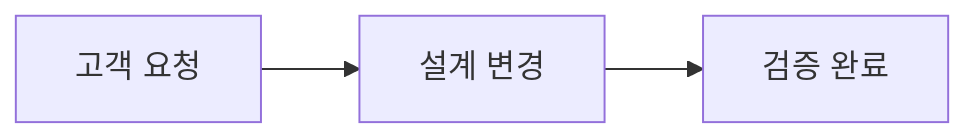

# 생각을 쓰고, 연결을 발견하세요
원문은 그대로, 결과는 미리보기로.

## 기록에서 업무의 흐름까지

## 수식도 간결하게
$$
\text{진행률} = \frac{8}{10} \times 100 = 80\%
$$

| 도구 | 기록하는 방법 |
| --- | --- |
| Markdown | 원문과 미리보기 |
| 기억지도 | 업무 관계와 원문 근거 |
| 로컬 AI | Ollama로 관계 탐색 |

> 작은 메모가 모여, 다음 판단의 근거가 됩니다.
